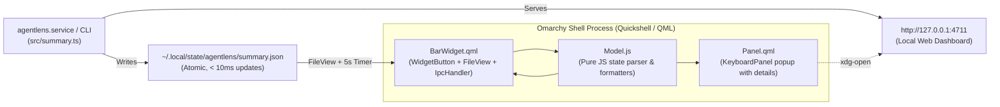

# Omarchy Quattro Plugin Specification: `agentlens.bar-widget` 🪟

This document specifies the architecture, file layout, QML components, and CLI workflow for the official **Omarchy Quattro** desktop plugin (`agentlens.bar-widget`) shipped with **agentlens**.

Official development reference: [Omarchy Plugin Development Guide](https://plugins.omarchy.org/develop.html)

---

## 🎯 Purpose & User Experience

The **agentlens Omarchy Plugin** embeds real-time AI coding agent intelligence directly into the native Omarchy Quattro desktop shell (`omarchy-shell`):
1. **Live Bar Widget (`BarWidget.qml`)**:
   - Sits in the Omarchy status bar (`defaultSection: "right"`).
   - Displays the most constrained ("binding") 5-hour quota utilization and reset countdown (e.g. `⚡ 68% (1h 42m)`).
   - Shows active token burn velocity (e.g. `🔥 42.1k/h`) when coding agents are active.
   - Color-coded semantic states conforming to Omarchy theme tokens (`Color` and `Style` from `qs.Commons`): Normal, Warning (`>= 80%`), and Danger (`>= 95%` or projected exhaustion within 30m).
   - **Left-click** toggles the floating panel; **Middle-click** refreshes state; **Right-click** opens the local dashboard (`http://127.0.0.1:4711`).
2. **Interactive Details Panel (`Panel.qml`)**:
   - Clicking the bar widget pops out an anchored floating panel (`KeyboardPanel` + `PanelKeyCatcher`).
   - Displays 5-hour and 7-day quota progress meters across active agents (Claude Code & Codex), exact exhaustion projections, today's measured tokens, API-equivalent cost (`$`), and top active projects.
   - Highlights the #1 priority **"Fix Now"** recommendation with a one-click prompt copy (`wl-copy` / `xclip`).
   - Quick action buttons to summon the full agentlens dashboard (`http://127.0.0.1:4711`) or refresh telemetry.

---

## 🏗️ Architecture & Data Integration

Because `agentlens` writes `~/.local/state/agentlens/summary.json` atomically (`< 10ms`) on every ingest cycle, the Omarchy plugin reads `summary.json` directly via Quickshell's native `FileView`:



---

## 📁 Repository & Installed Layout

Source files live in this repository under `plugins/omarchy/agentlens.bar-widget/` and install into `~/.config/omarchy/plugins/agentlens.bar-widget/`:

```
plugins/omarchy/agentlens.bar-widget/
├── manifest.json        # Omarchy Quattro schemaVersion 1 plugin contract
├── BarWidget.qml        # BarWidget item rendered in the active Omarchy bar
├── Panel.qml            # Floating KeyboardPanel detail surface summoned on click
├── Model.js             # Pure JS state normalizer and token/cost/duration formatters
├── assets/
│   └── icon.svg         # Agentlens badge icon for PanelHero
└── README.md            # Plugin documentation and IPC reference
```

---

## 🛠️ CLI Installation & Verification Workflow

1. **Install and enable directly via `agentlens` CLI**:
   ```bash
   agentlens plugin install --enable
   ```
2. **Check plugin installation and shell status**:
   ```bash
   agentlens plugin status
   ```
3. **Validate & query live widget state via Omarchy CLI**:
   ```bash
   omarchy plugin validate ~/.config/omarchy/plugins/agentlens.bar-widget
   omarchy-shell agentlens.bar-widget status
   omarchy-shell agentlens.bar-widget toggle
   ```
4. **Uninstall**:
   ```bash
   agentlens plugin uninstall
   ```
