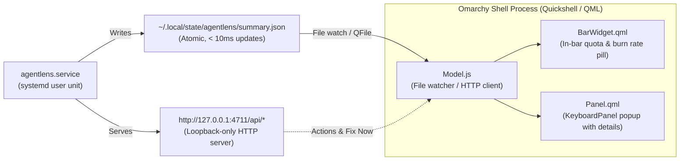

# Omarchy Quattro Plugin Specification: agentlens Bar Widget & Panel 🪟

This document specifies the architecture, file layout, QML components, and integration design for creating an official **Omarchy Quattro** desktop plugin for **agentlens**.

Official development reference: [Omarchy Plugin Development Guide](https://plugins.omarchy.org/develop.html)

---

## 🎯 Purpose & User Experience

The **agentlens Omarchy Plugin** embeds real-time AI coding agent intelligence directly into the native Omarchy desktop shell:
1. **Live Bar Widget (`BarWidget.qml`)**:
   - Sits in the Omarchy top/bottom status bar.
   - Displays real-time 5-hour quota utilization and reset countdown (e.g. `⚡ 68% (1h 42m)`).
   - Shows active token burn velocity (e.g. `🔥 42k/h`) when coding agents are active.
   - Color-coded semantic states conforming to Omarchy theme tokens (`Style.color`): Normal, Warning (>80%), and Danger (>95% or projected exhaustion within 30m).
2. **Interactive Details Panel (`Panel.qml`)**:
   - Clicking the bar widget pops out an anchored floating panel (`KeyboardPanel`).
   - Displays 5-hour and 7-day quota progress bars, exact exhaustion projections, today's measured tokens and API-equivalent cost.
   - Highlights the #1 priority "Fix Now" recommendation with a one-click prompt copy.
   - Quick action to summon the full agentlens dashboard (`http://127.0.0.1:4711`) in the default browser.

---

## 🏗️ Architecture & Data Integration

Because agentlens already runs as a local background systemd user service (`agentlens.service`), the Omarchy plugin requires **no background daemons or heavy polling loops**:



### Data Sources (Prioritized)
1. **Primary (`summary.json`)**:
   - Path: `~/.local/state/agentlens/summary.json` (or `$XDG_STATE_HOME/agentlens/summary.json`).
   - Precomputed by agentlens on every log flush in `< 10ms`.
   - Contains: active agent quotas (5h/7d % and reset timestamps), quota forecasts, active burn rate, and today's token counts.
   - Read directly via QtQuick / JavaScript file I/O for instantaneous, zero-latency rendering.
2. **Secondary (`http://127.0.0.1:4711`)**:
   - Used for interactive actions: opening dashboard (`xdg-open`), copying fix prompts (`/api/fix/prompt`), or retrieving detailed project recommendations (`/api/recommendations`).

---

## 📁 Repository & Plugin Layout

Omarchy plugins live in user space under `~/.config/omarchy/plugins/<plugin-id>/`:

```
~/.config/omarchy/plugins/agentlens.bar-widget/
├── manifest.json        # Omarchy Quattro plugin contract
├── BarWidget.qml        # Item rendered in the active Omarchy bar
├── Panel.qml            # Floating detail surface summoned on click
├── Model.js             # Data parser for summary.json and local API
├── assets/
│   ├── icon.svg         # Agentlens logo / bar icon
│   └── zap.svg          # Quota lightning badge
└── README.md            # Plugin documentation and setup instructions
```

---

## 📝 Manifest Specification (`manifest.json`)

Conforms strictly to `schemaVersion: 1` enforced by the Omarchy Quattro shell:

```json
{
  "schemaVersion": 1,
  "id": "agentlens.bar-widget",
  "name": "agentlens Monitor",
  "version": "1.0.0",
  "author": "Sohail Elskhawy",
  "license": "MIT",
  "description": "Live AI agent quota tracking, token burn speed, and waste alerts for Claude Code, Codex, OpenCode, and Antigravity.",
  "kinds": ["bar-widget"],
  "entryPoints": {
    "barWidget": "BarWidget.qml"
  },
  "barWidget": {
    "displayName": "agentlens Quota",
    "category": "Development",
    "allowMultiple": false,
    "defaultSection": "right"
  },
  "omarchy": {
    "clonedFrom": "omarchy.clock"
  }
}
```

---

## 💻 QML Component Implementations

### 1. `BarWidget.qml` (Bar Component)
Exposes `open()` and `close()` to control the child panel loader, handles click interactions, and formats the in-bar status pill:

```qml
import QtQuick
import Quickshell
import qs.Commons
import qs.Ui

Item {
  id: root
  moduleName: "agentlens.bar-widget"

  property var anchorItem: barButton
  property var hostWidget: root

  // Summary State parsed from Model.js
  property int quota5hPct: 0
  property string quota5hReset: ""
  property int tokensToday: 0
  property int burnRatePerHour: 0
  property bool isWarning: quota5hPct >= 80 && quota5hPct < 95
  property bool isDanger: quota5hPct >= 95

  implicitWidth: barButton.implicitWidth
  implicitHeight: barButton.implicitHeight

  Timer {
    interval: 5000
    running: true
    repeat: true
    triggeredOnStart: true
    onTriggered: Model.updateSummary(root)
  }

  Loader {
    id: panelLoader
    active: false
    asynchronous: true
    source: "Panel.qml"
    onLoaded: {
      item.anchorItem = root.anchorItem
      item.hostWidget = root
      item.bar = root.bar
      item.open()
    }
  }

  function open() {
    if (panelLoader.item) panelLoader.item.open()
    else panelLoader.active = true
  }

  function close() {
    if (panelLoader.item) panelLoader.item.close()
  }

  function toggle() {
    if (panelLoader.item && panelLoader.item.opened) close()
    else open()
  }

  BarButton {
    id: barButton
    anchors.fill: parent
    onClicked: root.toggle()

    content: Row {
      spacing: Style.space(6)
      anchors.verticalCenter: parent.verticalCenter

      // Lightning Icon
      Icon {
        name: "flash"
        size: Style.icon.small
        color: root.isDanger ? Style.color.danger : (root.isWarning ? Style.color.warning : Style.color.accent)
      }

      // 5h Quota Percentage
      Text {
        text: root.quota5hPct > 0 ? (root.quota5hPct + "%") : "--"
        color: root.isDanger ? Style.color.danger : (root.isWarning ? Style.color.warning : root.barForeground)
        font.family: root.bar ? root.bar.fontFamily : Style.font.family
        font.pixelSize: Style.font.caption
        font.bold: true
      }

      // Reset Countdown
      Text {
        text: root.quota5hReset !== "" ? ("(" + root.quota5hReset + ")") : ""
        color: Style.color.textMuted
        font.family: root.bar ? root.bar.fontFamily : Style.font.family
        font.pixelSize: Style.font.nano
        visible: root.quota5hReset !== ""
      }
    }
  }
}
```

### 2. `Panel.qml` (Anchored Floating Details Panel)
Summoned on click; anchored directly under the bar button:

```qml
import QtQuick
import Quickshell
import qs.Commons
import qs.Ui

Panel {
  id: root
  moduleName: "agentlens.bar-widget"
  manageIpc: false

  property var anchorItem: null
  property var hostWidget: null

  function open() { root.controller.show() }
  function close() { root.controller.hide() }

  KeyboardPanel {
    id: panel
    anchorItem: root.anchorItem
    owner: root.hostWidget || root
    bar: root.bar
    open: root.opened
    focusTarget: keyCatcher
    contentWidth: panel.fittedContentWidth(Style.space(320))
    contentHeight: panel.fittedContentHeight(contentCol.implicitHeight + Style.space(24))

    PanelKeyCatcher {
      id: keyCatcher
      anchors.fill: parent
      onCloseRequested: root.close()

      Column {
        id: contentCol
        width: parent.width - Style.space(24)
        anchors.horizontalCenter: parent.horizontalCenter
        spacing: Style.space(12)
        topPadding: Style.space(12)

        // Header Title
        Row {
          width: parent.width
          spacing: Style.space(8)
          Text {
            text: "agentlens Monitor"
            color: root.barForeground
            font.pixelSize: Style.font.title
            font.bold: true
          }
          Item { Layout.fillWidth: true }
          StatusBadge {
            text: "LIVE"
            status: "success"
          }
        }

        Divider {}

        // 5-Hour Limit Bar
        Column {
          width: parent.width
          spacing: Style.space(4)
          Row {
            width: parent.width
            Text { text: "Claude 5h Limit"; color: Style.color.textMuted; font.pixelSize: Style.font.caption }
            Item { Layout.fillWidth: true }
            Text { text: (hostWidget ? hostWidget.quota5hPct : 0) + "%"; font.bold: true; color: root.barForeground }
          }
          ProgressBar {
            width: parent.width
            value: (hostWidget ? hostWidget.quota5hPct : 0) / 100.0
            color: hostWidget && hostWidget.isDanger ? Style.color.danger : (hostWidget && hostWidget.isWarning ? Style.color.warning : Style.color.accent)
          }
        }

        // Daily Totals & Burn Rate
        Row {
          width: parent.width
          spacing: Style.space(8)

          StatBox {
            title: "Today's Tokens"
            value: Model.formatTokens(hostWidget ? hostWidget.tokensToday : 0)
            width: (parent.width - Style.space(8)) / 2
          }

          StatBox {
            title: "Burn Rate"
            value: Model.formatTokens(hostWidget ? hostWidget.burnRatePerHour : 0) + "/h"
            width: (parent.width - Style.space(8)) / 2
          }
        }

        Divider {}

        // Quick Launch Buttons
        Row {
          width: parent.width
          spacing: Style.space(8)

          Button {
            text: "Open Dashboard"
            width: parent.width
            onClicked: {
              Qt.openUrlExternally("http://127.0.0.1:4711")
              root.close()
            }
          }
        }
      }
    }
  }
}
```

### 3. `Model.js` (State Reading & Utilities)
```javascript
// Reads ~/.local/state/agentlens/summary.json directly or falls back to fetch
function updateSummary(widget) {
  var xhr = new XMLHttpRequest();
  xhr.open("GET", "http://127.0.0.1:4711/api/quota", true);
  xhr.onreadystatechange = function() {
    if (xhr.readyState === XMLHttpRequest.DONE) {
      if (xhr.status === 200) {
        try {
          var data = JSON.parse(xhr.responseText);
          if (data && data.windows && data.windows["5h"]) {
            var w = data.windows["5h"];
            widget.quota5hPct = Math.round(w.percent || 0);
            if (w.resetsAt) {
              var diffMin = Math.max(0, Math.round((w.resetsAt - Date.now()) / 60000));
              var hours = Math.floor(diffMin / 60);
              var mins = diffMin % 60;
              widget.quota5hReset = (hours > 0 ? (hours + "h ") : "") + mins + "m";
            }
          }
        } catch (e) {}
      }
    }
  };
  xhr.send();
}

function formatTokens(n) {
  if (!n) return "0";
  if (n >= 1000000) return (n / 1000000).toFixed(1) + "M";
  if (n >= 1000) return (n / 1000).toFixed(1) + "k";
  return String(n);
}
```

---

## 🛠️ Installation & Verification Workflow

1. **Clone built-in clock as scaffold in Omarchy**:
   ```bash
   omarchy plugin clone omarchy.clock --edit
   ```
2. **Copy agentlens plugin files to user config**:
   ```bash
   mkdir -p ~/.config/omarchy/plugins/agentlens.bar-widget
   # Place manifest.json, BarWidget.qml, Panel.qml, Model.js into the folder
   ```
3. **Validate the plugin contract**:
   ```bash
   omarchy plugin validate ~/.config/omarchy/plugins/agentlens.bar-widget
   qmllint -I "$OMARCHY_PATH/shell" ~/.config/omarchy/plugins/agentlens.bar-widget/BarWidget.qml ~/.config/omarchy/plugins/agentlens.bar-widget/Panel.qml
   ```
4. **Rescan & Enable in Omarchy Shell**:
   ```bash
   omarchy-shell shell rescanPlugins
   omarchy plugin enable agentlens.bar-widget
   ```
