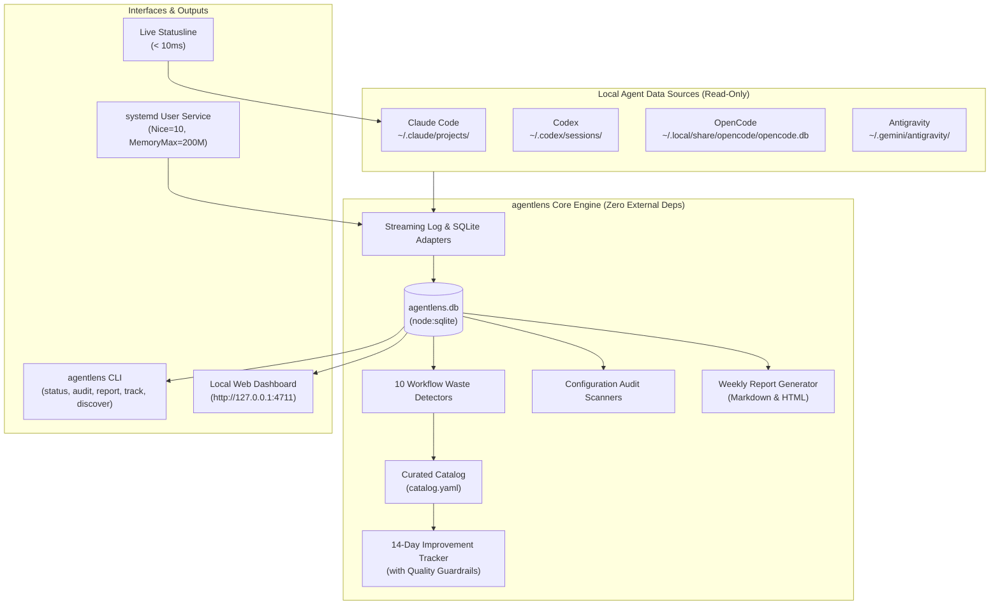

# agentlens 🔍

[](LICENSE)
[](https://nodejs.org)
[](package.json)
[](#privacy--security-guarantees)
[](test/)

**agentlens** is a lightweight, local-first Linux usage and workflow optimizer for AI coding agents:
- **Claude Code** (Pro)
- **Codex** (Plus)
- **OpenCode** (Go)
- **Antigravity** (Pro)

It monitors how you use AI coding agents to **save tokens, avoid hitting subscription usage limits, and eliminate repetitive agent workflows** — globally and per project.


---

## ⚡ Key Capabilities

* **Unified Usage Dashboard:** Historical and continuous token consumption, session replays, model tier breakdowns, per-project costs, and active quotas.
* **Quota Guard & Statusline:** Live 5-hour and 7-day rate-limit tracking for Claude Code (< 10ms latency) and Codex with reset countdowns and limit warnings.
* **Workflow Waste Detectors:** 10 deterministic analyzers that detect retry loops, repetitive file reads, runaway context growth, idle cache misses, large tool dumps, and model mismatch.
* **Configuration Audit:** Scans global and project instructions (`CLAUDE.md`, `AGENTS.md`, `GEMINI.md`), MCP servers, skills, and plugins. Calculates fixed session token overhead and detects unused (30d), duplicate, or conflicting configurations.
* **Smart Recommendations & Curated Catalog:** Synthesizes findings into ranked, copyable actions enriched with vetted open-source tools from `catalog.yaml`.
* **Automated Weekly Usage Reports:** Generates comprehensive Monday reports in GitHub-flavored Markdown and standalone dark/light HTML (`~/.local/share/agentlens/reports/`), with desktop notifications.
* **Improvement Tracking with Quality Guardrails:** Tracks accepted recommendations across 14-day before/after windows, verifying real token savings while ensuring error rates and interaction turns don't regress.
* **Opt-In Tool Discovery:** Searches GitHub for relevant agent tools and MCPs using generic search queries without transmitting private code or prompts.

---

## 📸 Visual Tour

### 1. Recommendations & Improvement Tracking
Synthesizes findings into actionable recommendations with copyable snippets. Accepts recommendations and tracks 14-day before/after token deltas while enforcing error-rate guardrails.


### 2. Configuration Audit
Calculates fixed instruction token tax per session, audits 30-day usage of MCP tools and skills, and flags duplicate configurations across agents.


### 3. Automated Weekly Usage Reports
Comprehensive weekly executive summary: week-over-week trends, quota near-misses, top wasting patterns, and top 3 priorities for next week.


### 4. Curated Catalog & Privacy-Safe Tool Discovery
Browse vetted tools mapped to token-waste rules (Serena, Repomix, Context7, ccusage), or discover new tools from GitHub using privacy-safe generic queries.


---

## 🏗 Architecture



---

## 🚀 Quick Start

### 1. Requirements
- Linux (Ubuntu, Debian, Fedora, Arch, etc.)
- Node.js ≥ 22.18 (built with native SQLite and type-stripping support)
- Zero runtime npm dependencies required

### 2. Installation & Running

```bash
# Clone the repository
git clone https://github.com/sohail/agentlens.git
cd agentlens

# Install devDependencies (TypeScript for typechecking/tests)
npm install

# Perform an initial one-shot backfill from your agent logs
./bin/agentlens ingest

# Start the continuous watcher and dashboard
./bin/agentlens serve
```

Open **http://127.0.0.1:4711** in your browser.

### 3. Optional: Global CLI Install
To make `agentlens` available anywhere in your terminal:
```bash
npm link
# Or install globally from checkout:
npm install -g .
```

### 4. Background Service (Systemd)
To keep agentlens continuously running in the background on user login:
```bash
agentlens install-service
systemctl --user daemon-reload
systemctl --user enable --now agentlens
```

To restart or stop:
```bash
systemctl --user restart agentlens
systemctl --user stop agentlens
```

### 5. Claude Code Live Statusline
Configure Claude Code to display real-time token usage and quota status in your prompt bar (< 10ms latency):
```bash
agentlens install-statusline
```
Add this snippet to `~/.claude/settings.json`:
```json
{
  "statusLine": {
    "command": "agentlens statusline"
  }
}
```

---

## 💻 CLI Reference

| Command | Description |
|---|---|
| `agentlens serve` | Continuously ingest agent data and serve dashboard on `http://127.0.0.1:4711` |
| `agentlens ingest` | Perform an incremental backfill of all 4 agents into SQLite and exit |
| `agentlens status [--project <path>]` | Terminal summary of token usage, estimated costs, and active quotas |
| `agentlens audit [--project <path>]` | Audit instruction overhead, unused MCPs/skills, duplicates, and conflicts |
| `agentlens report [--week YYYY-Www] [--html] [--json]` | Generate and display weekly usage report |
| `agentlens track [--project <path>]` | Display before/after improvement tracking for accepted recommendations |
| `agentlens accept <id>` | Accept a recommendation and start 14-day improvement tracking |
| `agentlens catalog [--rule <name>] [--json]` | Browse curated tool & MCP catalog mapped to waste patterns |
| `agentlens discover [--query <terms>] [--dry-run] [--json]` | Opt-in discovery of agent tools and MCPs from GitHub |
| `agentlens statusline` | Streamlined stdin processor for Claude Code statusline payload |
| `agentlens install-statusline` | Print configuration instructions for Claude Code statusline |
| `agentlens install-service` | Install systemd user service (`~/.config/systemd/user/agentlens.service`) |

---

## 🔒 Privacy & Security Guarantees

agentlens is engineered from the ground up to respect developer privacy and system security:
- **Strictly Read-Only on Agent Files:** Agent log files and SQLite databases are opened with read-only flags (`mode=ro`). agentlens **never** modifies agent configurations, installs tools, or alters session histories.
- **Zero Raw Prompt or Output Storage:** Prompt text and tool outputs are never persisted to disk. Only SHA-256 hashes and byte lengths are recorded for repetition detection.
- **Strict Network Isolation:** Dashboard binds exclusively to loopback (`127.0.0.1`) with DNS rebinding host protection. No analytics, telemetry, or external AI model calls are made.
- **Zero Agent Token Allowance:** agentlens never injects prompt instructions or SessionStart hooks into active coding sessions.
- **Privacy-Safe Discovery:** The optional GitHub discovery engine operates strictly on generic alphanumeric keyword queries. Local paths, project names, or token metrics are never transmitted.

---

## 📊 Three Numbers Kept Strictly Separate

agentlens strictly distinguishes three distinct metrics to avoid confusion:
1. **Measured Tokens:** Exact input, output, cache-read, cache-write, and reasoning tokens extracted directly from agent JSONL logs and SQLite databases.
2. **Estimated API Cost:** Theoretical pay-as-you-go API cost calculated from a bundled LiteLLM price snapshot (informative comparison, not actual subscription billing).
3. **Reported Subscription Quota:** Actual percentage of the rolling 5-hour and 7-day usage limits reported directly by Claude Code and Codex rate-limit headers.

---

## 📁 Agent Data Sources & Compatibility

| Agent | Log / Database Path | Tokens Tracked | Quota Support |
|---|---|---|---|
| **Claude Code** | `~/.claude/projects/*/*.jsonl` | Input, output, reasoning, cache read/write (5m/1h) | Live 5h / 7d percentage & resets |
| **Codex** | `~/.codex/sessions/YYYY/MM/DD/rollout-*.jsonl` | Input (deduped cache), output, reasoning, cache read | 5h / 7d rate limits from session events |
| **OpenCode** | `~/.local/share/opencode/opencode.db` | Messages, tokens (input/output/reasoning/cache), tools | Session metrics (`n/a` for quota) |
| **Antigravity** | `~/.gemini/antigravity/conversation_summaries.db` | Sessions, workspace roots, ccusage bridge | Session metrics (`n/a` for quota) |

---

## 🛠 Configuration

| Environment Variable | Default Path | Purpose |
|---|---|---|
| `AGENTLENS_DATA_DIR` | `~/.local/share/agentlens` | SQLite database (`agentlens.db`) and weekly reports |
| `AGENTLENS_STATE_DIR` | `~/.local/state/agentlens` | Live summary (`summary.json`) and Claude quota spool |
| `AGENTLENS_PORT` | `4711` | Dashboard HTTP listening port |
| `AGENTLENS_SOURCE_HOME` | `$HOME` | Home directory scanned for agent logs |
| `GITHUB_TOKEN` | *(optional)* | Personal access token for higher GitHub discovery rate limits |

---

## 🧪 Testing & Verification

```bash
# Run test suite (119 unit & integration tests)
npm test

# Run TypeScript typecheck
npm run typecheck

# Check dashboard syntax
node --check web/app.js

# Update bundled LiteLLM price snapshot (dev only)
npm run update-prices
```

---

## 🤝 Contributing

We welcome contributions! Please read our [Contributing Guide](CONTRIBUTING.md) to learn about our architecture, coding guidelines, and PR workflow.

1. Fork the repo and create your branch from `master`.
2. Ensure `npm test && npm run typecheck && node --check web/app.js` passes.
3. Submit a Pull Request!

---

## 🤝 Open Source Acknowledgments

agentlens incorporates concepts and parsing techniques inspired by open-source projects in the developer community:
- [ccusage](https://github.com/ccusage/ccusage) (MIT) — Claude Code token and quota parsing.
- [TraceRoost](https://github.com/traceroost/core) (MIT) — Multi-agent workflow and subagent tracing ideas.
- [Tokenomics](https://github.com/galando/tokenomics) (MIT) — Model tier expenditure heuristics.
- [agent-audit](https://github.com/Back-Road-Creative/agent-audit) (MIT) — Tool retry sequence analysis.
- [mcp-tokens](https://github.com/sd2k/mcp-tokens) (MIT) — Tool schema overhead estimation.
- [uPlot](https://github.com/leeoniya/uPlot) (MIT) — Ultra-fast time-series canvas charts.
- [LiteLLM](https://github.com/BerriAI/litellm) — Community pricing snapshot reference.

---

## 📜 License

[MIT License](LICENSE) © 2026 agentlens authors.
