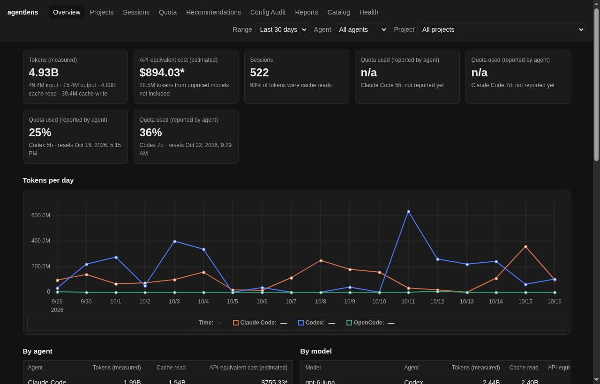
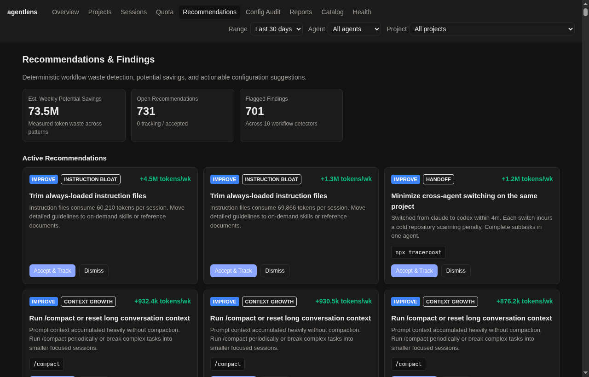
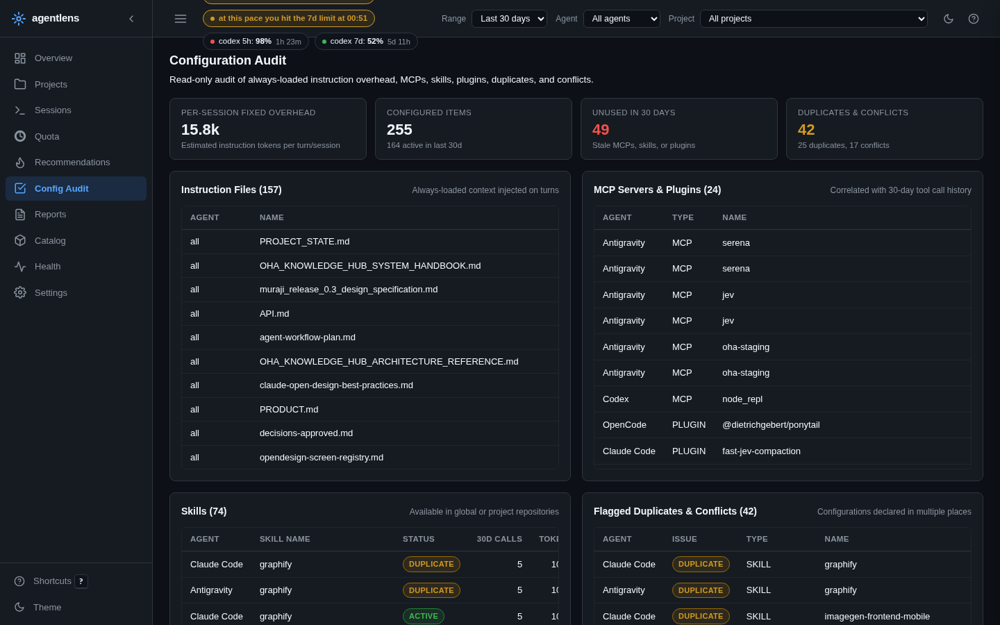
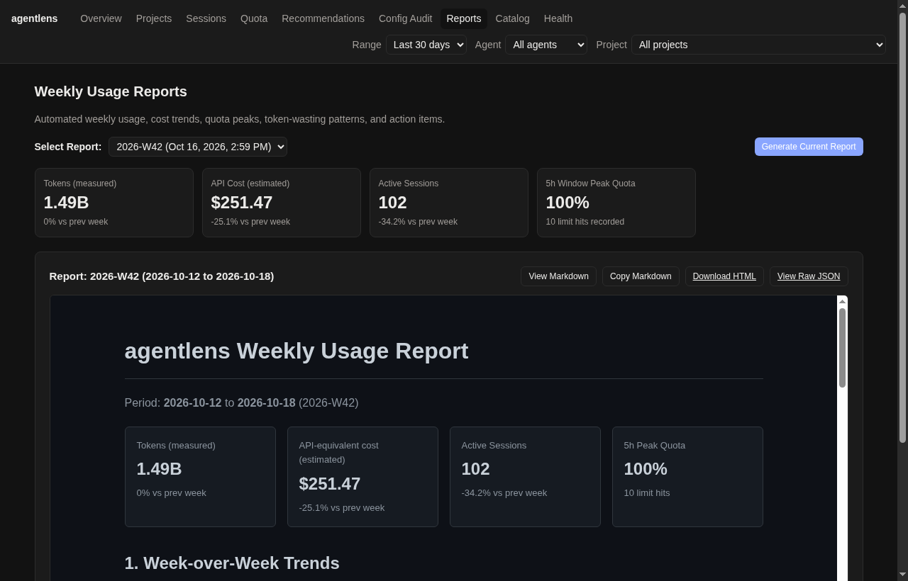
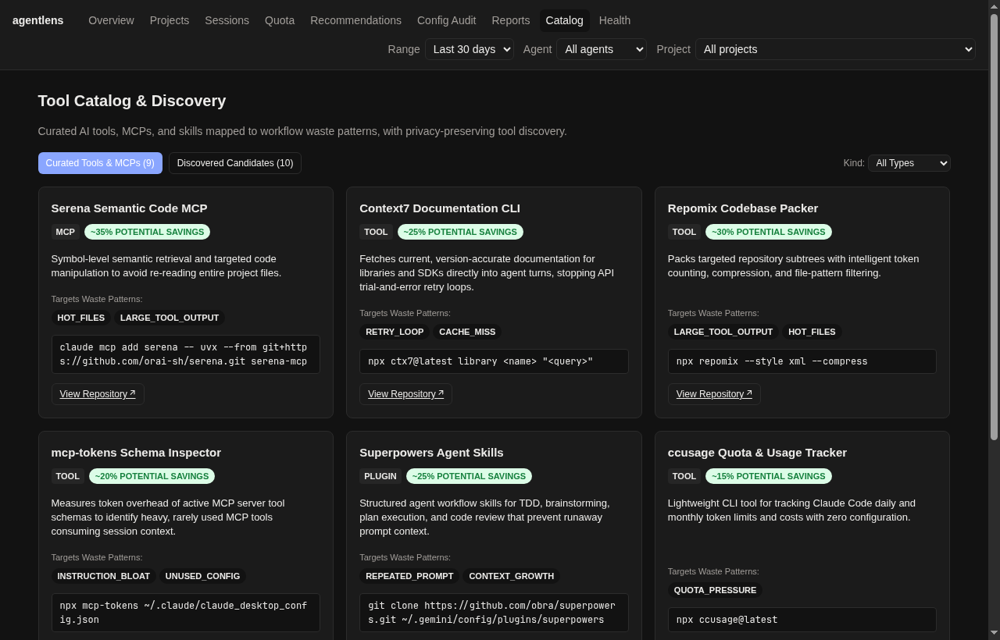
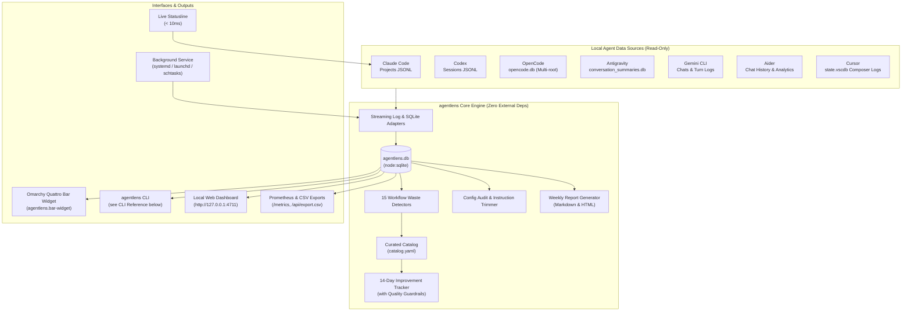

# agentlens 🔍

[](LICENSE)
[](https://nodejs.org)
[](package.json)
[](#privacy--security-guarantees)

**agentlens** is a lightweight, local-first, cross-platform usage and workflow optimizer for AI coding agents on Linux, macOS, and Windows:
- **Claude Code** (Pro)
- **Codex** (Plus)
- **OpenCode** (Go)
- **Antigravity** (Pro)
- **Gemini CLI**
- **Aider**
- **Cursor**

It monitors how you use AI coding agents to **save tokens, avoid hitting subscription usage limits, and eliminate repetitive agent workflows** — globally and per project.



---

## ⚡ Key Capabilities

* **Unified Usage Dashboard (Fluid & Responsive):** Fluid full-width 12-column responsive layout, dense KPI bar, side-by-side uPlot canvas charts, dark/light token design system, collapsible sidebar, and slide-over drawers.
* **"Fix Now" Project Action Runner:** Instant project fix panel ranking open recommendations by estimated tokens saved, with one-click copyable prompts and opt-in "Send to agent" CLI dispatch (`claude`, `codex`, `opencode`) capturing live `git diff --stat`.
* **Quota Forecasting & Live Statusline:** Burn rate extrapolation projecting 5-hour and 7-day rate-limit exhaustion times before reset (< 10ms latency in statusline, CLI status, and dashboard top bar).
* **Omarchy Quattro Desktop Bar Widget (`agentlens.bar-widget`):** Native Quickshell/QML top-bar pill and slide-out telemetry panel with reactive `FileView` watching (`~/.local/state/agentlens/summary.json`), multi-agent 5h/7d progress bars, live token burn velocity (`🔥 X/h`), Today's Activity KPIs, and one-click "Fix Now" prompt copy.
* **Live Desktop Alerts:** Proactive notifications during `serve` for active retry loops, quota exhaustion predicted within 30 minutes, or project budgets crossing 80%/100%.
* **Per-Project Weekly Budgets:** Configurable weekly token and cost targets per project with visual progress bars and weekly report integration.
* **Cross-Agent Quota Balancing:** Evaluates quota headroom across agents to recommend optimal agent switching.
* **15 Workflow Waste Detectors:** Deterministic detectors covering retry loops, repetitive file reads, context runaway, idle cache misses, large tool dumps, model mismatch, git outcome efficiency, abandoned sessions, compaction churn, and reasoning overuse.
* **Interactive Session Turn Timeline:** Per-turn stacked token charts (input, output, cache-read) with clickable detector event markers and finding slide-over views.
* **Instruction Trimmer:** Generates non-destructive unified diffs proposing cuts for duplicate lines, conflicting rules, oversized code blocks, and stale paths across `CLAUDE.md`, `AGENTS.md`, and `GEMINI.md`.
* **Configuration Audit:** Scans global and project instructions, MCP servers, skills, and plugins. Calculates fixed session token overhead and detects unused (30d), duplicate, or conflicting configurations.
* **Smart Recommendations & Curated Catalog:** Synthesizes findings into ranked actions enriched with vetted open-source tools from `catalog.yaml`. Finding `est_tokens_week` figures are heuristic estimates (capped by trailing-7-day usage of the finding's scope), not measurements; realized savings are only what `agentlens track` measures after an accepted recommendation.
* **Automated Weekly Usage Reports:** Generates comprehensive Monday reports in GitHub-flavored Markdown and standalone dark/light HTML (`<dataDir>/reports/`), with native desktop notifications across Linux (`notify-send`), macOS (`osascript`), and Windows (PowerShell toast).
* **Improvement Tracking with Quality Guardrails:** Tracks accepted recommendations across 14-day before/after windows, verifying real token savings while ensuring error rates and interaction turns don't regress.
* **Flexible Exports & Prometheus Metrics:** CLI exporter (`agentlens export --format csv|json`), `GET /api/export.csv`, Prometheus `GET /metrics` text endpoint, and in-dashboard CSV table downloads.
* **Multi-Platform Reach:** Full Linux, macOS (`launchd`, `osascript`), and Windows (`schtasks`) support with graceful Antigravity degradation and adapters for Gemini CLI, Aider, and Cursor.

---

## 📸 Visual Tour

### 1. Recommendations & Improvement Tracking
Synthesizes findings into actionable recommendations with copyable snippets. Accepts recommendations and tracks 14-day before/after token deltas while enforcing error-rate guardrails.



### 2. Configuration Audit
Calculates fixed instruction token tax per session, audits 30-day usage of MCP tools and skills, and flags duplicate configurations across agents.



### 3. Automated Weekly Usage Reports
Comprehensive weekly executive summary: week-over-week trends, quota near-misses, top wasting patterns, and top 3 priorities for next week.



### 4. Curated Catalog & Privacy-Safe Tool Discovery
Browse vetted tools mapped to token-waste rules (Serena, Repomix, Context7, ccusage), or discover new tools from GitHub using privacy-safe generic queries.



---

## 🏗 Architecture



---

## 🚀 Quick Start

### 1. Requirements
- Operating System: Linux (Ubuntu, Debian, Fedora, Arch, etc.), macOS (Sonoma, Sequoia, etc.), or Windows 10/11
- Node.js ≥ 22.18 (built with native SQLite and type-stripping support)
- Zero runtime npm dependencies required

### 2. Installation & Running

```bash
# Clone the repository
git clone https://github.com/SohailElskhawy/agentlens.git
cd agentlens

# Install devDependencies (TypeScript for typechecking/tests)
npm install

# Perform an initial one-shot backfill from your agent logs
# Linux / macOS:
./bin/agentlens ingest
# Windows (Command Prompt):
.\bin\agentlens.cmd ingest
# Windows (PowerShell):
.\bin\agentlens.ps1 ingest

# Start the continuous watcher and dashboard
# Linux / macOS:
./bin/agentlens serve
# Windows (Command Prompt):
.\bin\agentlens.cmd serve
# Windows (PowerShell):
.\bin\agentlens.ps1 serve
```

Open **http://127.0.0.1:4711** in your browser.

### 3. Optional: Global CLI Install
To make `agentlens` available anywhere in your terminal:
```bash
npm link
# Or install globally from checkout:
npm install -g .
```

### 4. Background Service Setup (`install-service`)
Run `agentlens install-service` to configure agentlens to start automatically in the background on user login. The installer automatically detects your operating system and creates native daemon configurations:

#### Linux (`systemd`)
Generates user unit `~/.config/systemd/user/agentlens.service` with resource caps (`Nice=10`, `MemoryMax=200M`):
```bash
agentlens install-service
systemctl --user daemon-reload
systemctl --user enable --now agentlens
```
- **Check status / logs:** `systemctl --user status agentlens` or `journalctl --user -u agentlens -f`
- **Restart / Stop:** `systemctl --user restart agentlens` or `systemctl --user stop agentlens`
- *(Optional)* Keep running without an active login session: `loginctl enable-linger $USER`

#### macOS (`launchd`)
Generates LaunchAgent `~/Library/LaunchAgents/com.agentlens.plist` with output logging to `<stateDir>/agentlens.log`:
```bash
agentlens install-service
launchctl load -w ~/Library/LaunchAgents/com.agentlens.plist
```
- **Check logs:** `tail -f ~/Library/Caches/agentlens/agentlens.log`
- **To unload / stop:** `launchctl unload -w ~/Library/LaunchAgents/com.agentlens.plist`

#### Windows (Task Scheduler / `schtasks`)
Creates `%LOCALAPPDATA%\agentlens\agentlens-service.cmd` and outputs the `schtasks` registration command to register an `onlogon` task:
```cmd
:: 1. Generate helper script and display the exact registration command
agentlens.cmd install-service

:: 2. Register the logon task (execute the schtasks command output by install-service)
schtasks /create /tn "agentlens" /tr "\"%ProgramFiles%\nodejs\node.exe\" --no-warnings=ExperimentalWarning \"%USERPROFILE%\agentlens\src\cli.ts\" serve" /sc onlogon /f

:: 3. Start the service immediately without logging out/in
schtasks /run /tn "agentlens"
```
- **To stop:** `schtasks /end /tn "agentlens"`
- **Manual inspection & testing:** `%LOCALAPPDATA%\agentlens\agentlens-service.cmd` is available to execute or inspect directly in Command Prompt / PowerShell for debugging.

### 5. Claude Code Live Statusline
Configure Claude Code to display real-time token usage and quota status in your prompt bar (< 10ms latency).

Run `agentlens install-statusline` to display the exact configuration snippet for your operating system:
```bash
agentlens install-statusline
```

Add the printed snippet to `~/.claude/settings.json` (or `%USERPROFILE%\.claude\settings.json` on Windows):

**Linux & macOS:**
```json
{
  "statusLine": {
    "command": "agentlens statusline"
  }
}
```

**Windows (Command Prompt & PowerShell):**
```json
{
  "statusLine": {
    "command": "agentlens.cmd statusline"
  }
}
```

### 6. Omarchy Quattro Desktop Plugin (`agentlens.bar-widget`)
If you run **Omarchy Quattro** on Linux, install and enable the native top-bar widget and slide-out telemetry panel:

```bash
# Install to ~/.config/omarchy/plugins/agentlens.bar-widget, validate, and enable in the bar
agentlens plugin install --enable

# Check installation & shell status
agentlens plugin status

# Query live telemetry or force a refresh via Omarchy IPC
omarchy-shell agentlens.bar-widget status
omarchy-shell agentlens.bar-widget refresh

# Disable and uninstall
agentlens plugin uninstall
```

---

## 💻 CLI Reference

| Command | Description |
|---|---|
| `agentlens serve` | Continuously ingest agent data and serve dashboard on `http://127.0.0.1:4711` |
| `agentlens ingest` | Perform an incremental backfill of all supported agents (Claude Code, Codex, OpenCode, Antigravity, Gemini CLI, Aider, Cursor) into SQLite and exit |
| `agentlens export [--format csv\|json] [--type sessions\|daily\|findings\|all] [--from <date>] [--to <date>] [--project <path>] [--agent <agent>]` | Export session history, daily aggregates, or waste findings to CSV or JSON |
| `agentlens status [--project <path>]` | Terminal summary of token usage, estimated costs, and active quotas |
| `agentlens audit [--project <path>]` | Audit instruction overhead, unused MCPs/skills, duplicates, and conflicts |
| `agentlens report [--week YYYY-Www] [--html] [--json]` | Generate and display weekly usage report |
| `agentlens track [--project <path>]` | Display before/after improvement tracking for accepted recommendations |
| `agentlens accept <id>` | Accept a recommendation and start 14-day improvement tracking |
| `agentlens catalog [--rule <name>] [--json]` | Browse curated tool & MCP catalog mapped to waste patterns |
| `agentlens discover [--query <terms>] [--dry-run] [--json] [--token <pat>]` | Opt-in discovery of agent tools and MCPs from GitHub |
| `agentlens statusline [--format default\|starship\|raw]` | Streamlined stdin processor for Claude Code statusline payload; see [Live statusline output formats](#live-statusline-output-formats) |
| `agentlens cheatsheet [path] [--project <path>] [--top <N>] [--json]` | Generate a local Markdown architecture cheat-sheet from a project's top hot files; see [Analytics & cheat-sheet](#analytics--cheat-sheet) |
| `agentlens roi [--plan pro\|max5x\|max20x] [--days <N>] [--json]` | Compare locally observed Claude estimated API cost with an illustrative US monthly list-price reference |
| `agentlens savings [--project <path>] [--weeks <N>] [--json] [--snapshot]` | Weekly project token-metric comparison against a captured baseline (default 8 weeks) |
| `agentlens optimize [<path>] [--ai] [--preview] [--confirm <hash>] [--apply] [--dry-run] [--json]` | Workspace hygiene or opt-in AI instruction rewrite (`--apply` writes a `.bak` backup); see [docs/ai.md](docs/ai.md) |
| `agentlens install-statusline` | Print configuration instructions for Claude Code statusline |
| `agentlens install-service` | Install native background service (systemd user unit, launchd agent, or Windows scheduled task) |
| `agentlens plugin [install\|status\|uninstall] [--enable] [--dir <path>]` | Install, inspect, or remove the native Omarchy Quattro desktop bar plugin (`agentlens.bar-widget`) |
| `agentlens ai [status\|enable\|disable\|preview <diagnose\|session> <id>]` | Opt-in AI settings and exact preview (off by default; see [docs/ai.md](docs/ai.md)) |
| `agentlens recommend [--ai] [--preview] [--confirm <hash>]` | Deterministic recommendations with optional, consented AI enrichment (see [docs/ai.md](docs/ai.md)) |
| `agentlens explain anomaly <date> <project> [--agent <agent>] [--preview] [--confirm <hash>] [--json]` | Explain a detected token spike with opt-in AI and exact preview consent |
| `agentlens diagnose <session-id> \| --worst <N> [--project <path>] [--preview] [--confirm <hash>] [--json]` | Opt-in AI diagnosis of structured session waste via your `claude` CLI; each new call needs its exact preview hash |

The read-only `agentlens roi` command and `GET /api/analytics/roi?plan=pro&days=30` provide an **estimated API/list-price comparison** for Claude-agent logs. Plans are `pro`, `max5x`, or `max20x` (default `pro`); days are 1–365 (default 30). Team plans are unsupported. The window includes its start and excludes its end. API cost includes only tokens with known model prices, and the result reports token coverage and separate token and plan price dates. The ratio is unavailable when there are no priced tokens. The US monthly list prices ($20/$100/$200, as of 2026-10-30; [Claude pricing](https://claude.com/pricing)) exclude taxes; annual and regional pricing are unsupported. Multiplying by days/30 is illustrative, not an invoice calculation. Conditional API credit benefits are excluded. Local logs can include API-billed Claude usage and omit web chat and other machines, so this is not actual subscription utilization or measured value.

Ordinary `optimize --apply` checks planned targets, destination directories, and backup availability before writing. Later filesystem changes or I/O errors can still leave partial results.

### Analytics & cheat-sheet

Two read-only JSON endpoints compare tools and models. Both accept the standard API filters:
`from` / `to` (epoch ms; the window includes its start and excludes its end), `agent`, and
`project` (numeric project ID).

- `GET /api/analytics/tool-failures` — tool errors and wasted retry tokens per (tool, project).
  An error is a paired tool result marked as an error. A retry is a repeat of an identical call
  (same session, tool, and argument hash) within the filtered window; its `wastedTokens` are the
  assistant tokens (input + output + cache read + cache write) between the previous attempt and
  the retry. The result is `{failures: [{tool, projectId, project, calls, errors, retries, wastedTokens}], totals}`
  over the same metrics, sorted by errors then wasted tokens. Calls with different arguments are
  never counted as retries, and no tool output or arguments are returned.
- `GET /api/analytics/model-efficiency` — one row per model: `name`, `sessions`, `tokens`
  (input + output + cache read + cache write), `tokensPerSession`, `avgTurns` (turns = assistant
  events per session), `toolErrorRate` (errors / tool calls), and `cacheReadRatio` (cache read /
  total tokens), the two ratios rounded to 3 decimals. A session that used several models is
  counted once per model, but its tool stats are attributed to that session's primary model
  (most tokens in the session; ties broken by name). Models without a recorded name are listed
  as `unknown`. Sorted by tokens descending.

`agentlens cheatsheet` generates a ~10-line starter architecture summary locally, with no AI and
no HTTP endpoint or dashboard page:

```bash
agentlens cheatsheet            # current project (or pass a path / --project <path>)
agentlens cheatsheet --top 10 --json
```

```markdown
## Architecture Cheat-Sheet (myproj)
- `src/cli.ts` (23 reads): `fn main(...)`, `fn run(...)`
```

It ranks the project's `hot_files` findings by summed evidence reads and extracts up to 12
exported symbols per file (functions, interfaces, types, consts/lets, classes) from
TypeScript/JavaScript only. Files are read with a 64 KiB cap, restricted to regular files inside
the project root; unreadable files and paths outside the root are skipped. `--top` defaults to 5
(clamped 1–20). Without hot-file evidence it falls back to a size-ranked scan of `src/`; those
fallback entries carry no read counts (`reads: 0`). It is a starting point for a CLAUDE.md
architecture section, not a complete project map.

### Live statusline output formats

`agentlens statusline [--format default|starship|raw]` reads the Claude Code statusline JSON from
stdin, spools its rate limits for quota tracking, and prints one line from `summary.json` for the
current working directory's project:

| Format | Example output | Notes |
|---|---|---|
| `default` | `myproj · 12.3k · 5h 18% · 7d 42% · at this pace you hit the 5h limit at 15:30` | Appends `[COMPACT RECOMMENDED]` when session context is large. |
| `starship` | `⚡ 18% 5h \| 12.3k/d \| at this pace you hit the 5h limit at 15:30` | Quota percent, today's tokens, forecast; no project name and no 7-day quota. |
| `raw` | `myproj<TAB>12.3k<TAB>18%<TAB>42%<TAB>forecast<TAB>warning` | Tab-separated: project, today's tokens, 5h, 7d, forecast, context warning. |

Missing fields print as `--`; tokens are compact (`12.3k`, `1.2M`). The forecast is the active
quota-exhaustion estimate (time of day when the limit will be hit, or a "limit currently
exhausted" message); it reflects the last `summary.json` written by `serve` or `ingest`, so
without those running the quota and token fields read `--`.

---

## 🔒 Privacy & Security Guarantees

agentlens is engineered from the ground up to respect developer privacy and system security:
- **Strictly Read-Only on Agent Files:** Agent log files and SQLite databases are opened with read-only flags (`mode=ro`). agentlens **never** modifies agent configurations, installs tools, or alters session histories.
- **Zero Raw Prompt or Output Storage:** Prompt text and tool outputs are never persisted to disk. Only SHA-256 hashes and byte lengths are recorded for repetition detection.
- **Strict Network Isolation:** Dashboard binds exclusively to loopback (`127.0.0.1`) with DNS rebinding host protection. Metrics (`/metrics`) and CSV exports (`/api/export.csv`) are strictly loopback-only. No analytics or telemetry. AI analysis is off by default and only runs when you opt in (see below and [docs/ai.md](docs/ai.md)).
- **Opt-In AI Diagnosis (Off by Default):** `agentlens diagnose` can ask your own installed `claude` CLI to explain a session's token waste. It never runs automatically (not on ingest, not on `serve`) and requires `agentlens ai enable`. Only a redacted, structured summary is sent (rule names, tool names, token counts, finding estimates): never prompt text, tool output, source code, or file paths. Every new call requires you to review the exact prompt and command with `--preview` and confirm its hash with `--confirm`. That CLI sends the prompt to whatever provider and account it is configured for, so that call uses your provider's subscription and quota and its data leaves your machine. Results are cached locally, calls are capped per day, and AI output never changes the deterministic findings or recommendations.
- **Zero Agent Token Allowance:** agentlens never injects prompt instructions or SessionStart hooks into active coding sessions.
- **Privacy-Safe Discovery:** The optional GitHub discovery engine operates strictly on generic alphanumeric keyword queries. Local paths, project names, or token metrics are never transmitted.
- **Opt-In Agent Automation (`Fix Now`):** Executing automated fixes via local agent CLIs (`claude`, `codex`, `opencode`) is strictly opt-in and disabled by default until explicitly enabled in Settings (`Allow agentlens to launch agents`). All CLI commands require confirmation displaying the exact command array and verified project folder, and are executed via direct `execFile`/`spawn` argument arrays (never a shell string) restricted solely to repositories already tracked by agentlens.

---

## 📊 Three Numbers Kept Strictly Separate

agentlens strictly distinguishes three distinct metrics to avoid confusion:
1. **Measured Tokens:** Exact input, output, cache-read, cache-write, and reasoning tokens extracted directly from agent JSONL logs and SQLite databases.
2. **Estimated API Cost:** Theoretical pay-as-you-go API cost calculated from a bundled LiteLLM price snapshot (informative comparison, not actual subscription billing).
3. **Reported Subscription Quota:** Actual percentage of the rolling 5-hour and 7-day usage limits reported directly by Claude Code and Codex rate-limit headers.

---

## 📁 Platform Path Locations

agentlens automatically adheres to platform filesystem standards across Linux, macOS, and Windows:

| Path Item | Linux (XDG) | macOS (Darwin) | Windows |
|---|---|---|---|
| **Data Directory** (`dataDir`) | `~/.local/share/agentlens` | `~/Library/Application Support/agentlens` | `%LOCALAPPDATA%\agentlens` |
| **State Directory** (`stateDir`) | `~/.local/state/agentlens` | `~/Library/Caches/agentlens` | `%LOCALAPPDATA%\agentlens\state` |
| **Reports Directory** (`reportsDir`) | `<dataDir>/reports` | `<dataDir>/reports` | `<dataDir>\reports` |
| **SQLite Database** (`dbPath`) | `<dataDir>/agentlens.db` | `<dataDir>/agentlens.db` | `<dataDir>\agentlens.db` |
| **Live Summary** (`summaryPath`) | `<stateDir>/summary.json` | `<stateDir>/summary.json` | `<stateDir>\summary.json` |
| **Quota Spool** (`spoolPath`) | `<stateDir>/claude-quota.jsonl` | `<stateDir>/claude-quota.jsonl` | `<stateDir>\claude-quota.jsonl` |
| **Candidates Store** (`candidatesPath`) | `<dataDir>/discovery_candidates.json` | `<dataDir>/discovery_candidates.json` | `<dataDir>\discovery_candidates.json` |

> [!NOTE]
> **Path Overrides & Backwards Compatibility:**
> - `AGENTLENS_DATA_DIR` and `AGENTLENS_STATE_DIR` environment variables override default locations on all platforms.
> - **Legacy fallback:** If `~/.local/share/agentlens/agentlens.db` already exists on disk, agentlens continues using the legacy XDG path regardless of OS, ensuring zero migration friction.

---

## 📁 Agent Data Sources & Universal Discovery

agentlens performs read-only discovery of logs and session databases across Linux, macOS, and Windows:

| Agent | Platform Log / Database Locations | Tokens Tracked | Quota Support |
|---|---|---|---|
| **Claude Code** | • `CLAUDE_CONFIG_DIR`<br>• `<home>/.claude/projects/*/*.jsonl`<br>*(Identical structure on Linux, macOS, and `%USERPROFILE%\.claude\projects` on Windows)* | Input, output, reasoning, cache read/write (5m/1h) | Live 5h / 7d percentage & resets |
| **Codex** | • `CODEX_HOME`<br>• `<home>/.codex/sessions/YYYY/MM/DD/rollout-*.jsonl`<br>*(Identical structure on Linux, macOS, and `%USERPROFILE%\.codex\sessions` on Windows)* | Input (deduped cache), output, reasoning, cache read | 5h / 7d rate limits from session events |
| **OpenCode** | Multi-root candidate discovery searching for `opencode.db` in priority order:<br>1. **Linux**: `~/.local/share/opencode` (or `$XDG_DATA_HOME/opencode`)<br>2. **macOS**: `~/Library/Application Support/opencode`<br>3. **Windows**: `%APPDATA%\opencode` and `%LOCALAPPDATA%\opencode`<br>*(Config audit also scans `~/.config/opencode`, `~/Library/Application Support/opencode`, and `%APPDATA%\opencode` for `opencode.json`)* | Messages, tokens (input/output/reasoning/cache), tools | Session metrics (`n/a` for quota) |
| **Antigravity** | SQLite conversation summary database searched in priority order:<br>1. `<home>/.gemini/antigravity-cli/conversation_summaries.db`<br>2. `<home>/.gemini/antigravity/conversation_summaries.db`<br>*(Standard under user home directory on Linux, macOS, and Windows; degrades gracefully with dashboard warning when `ccusage` is absent)* | Sessions, workspace roots, ccusage bridge | Session metrics (`n/a` for quota) |
| **Gemini CLI** | Chat and turn session JSON logs searched across:<br>• `<home>/.gemini/tmp/*` and `<home>/.gemini/antigravity-cli/*` | Input, output, reasoning, cached tokens | Session metrics (`n/a` for quota) |
| **Aider** | Chat logs and telemetry searched across workspace roots:<br>• `.aider.chat.history.md`<br>• `.aider.input.history`<br>• `.aider.analytics.jsonl` | Session history, tokens, estimated cost | Session metrics (`n/a` for quota) |
| **Cursor** | SQLite composer state database (`state.vscdb`) searched in priority order:<br>1. **Linux**: `~/.config/Cursor/User/globalStorage/state.vscdb`<br>2. **macOS**: `~/Library/Application Support/Cursor/User/globalStorage/state.vscdb`<br>3. **Windows**: `%APPDATA%\Cursor\User\globalStorage\state.vscdb` | Composer prompts, token counters, models | Session metrics (`n/a` for quota) |

---

## 🛠 Configuration

| Environment Variable | Default Path (Linux / macOS / Windows) | Purpose |
|---|---|---|
| `AGENTLENS_DATA_DIR` | `~/.local/share/agentlens`<br>`~/Library/Application Support/agentlens`<br>`%LOCALAPPDATA%\agentlens` | SQLite database (`agentlens.db`), reports, and discovery candidates |
| `AGENTLENS_STATE_DIR` | `~/.local/state/agentlens`<br>`~/Library/Caches/agentlens`<br>`%LOCALAPPDATA%\agentlens\state` | Live summary (`summary.json`) and Claude quota spool |
| `AGENTLENS_PORT` | `4711` | Dashboard HTTP listening port |
| `AGENTLENS_SOURCE_HOME` | User home directory (`$HOME` or `%USERPROFILE%`) | Base home directory scanned for agent logs |
| `GITHUB_TOKEN` | *(optional)* | Personal access token for higher GitHub discovery rate limits |

---

## 🧪 Testing & Verification

```bash
# Run test suite
npm test

# Run TypeScript typecheck
npm run typecheck

# Check dashboard syntax
node --check web/app.js

# Update bundled LiteLLM price snapshot (dev only)
npm run update-prices
```

---

## 🤝 Contributing

We welcome contributions! Please read our [Contributing Guide](CONTRIBUTING.md) to learn about our architecture, coding guidelines, and PR workflow.

1. Fork the repo and create your branch from `master`.
2. Ensure `npm test && npm run typecheck && node --check web/app.js` passes.
3. Submit a Pull Request!

---

## 🗺️ Roadmap & Integrations

- **[ROADMAP.md](ROADMAP.md)** — Architectural proposals for in-flight guardrails via MCP, automated ignore generation, git branch cost attribution, and terminal UI (`agentlens tui`).
- **[OMARCHY_PLUGIN.md](OMARCHY_PLUGIN.md)** & **[`plugins/omarchy/agentlens.bar-widget/`](plugins/omarchy/agentlens.bar-widget/README.md)** — Shipped native **Omarchy Quattro** desktop bar widget and slide-out telemetry panel (`BarWidget.qml`, `Panel.qml`, `Model.js`), managed via `agentlens plugin install --enable`.
- **[VSCODE_EXTENSION.md](VSCODE_EXTENSION.md)** — Full specification for the **VS Code & Cursor** extension (`vscode-agentlens`), including ambient status bar quota monitoring, workspace Fix Now tree view, and in-editor instruction trimmer diff preview.

---

## 🤝 Open Source Acknowledgments

agentlens incorporates concepts and parsing techniques inspired by open-source projects in the developer community:
- [ccusage](https://github.com/ccusage/ccusage) (MIT) — Claude Code token and quota parsing.
- [TraceRoost](https://github.com/traceroost/core) (MIT) — Multi-agent workflow and subagent tracing ideas.
- [Tokenomics](https://github.com/galando/tokenomics) (MIT) — Model tier expenditure heuristics.
- [agent-audit](https://github.com/Back-Road-Creative/agent-audit) (MIT) — Tool retry sequence analysis.
- [mcp-tokens](https://github.com/sd2k/mcp-tokens) (MIT) — Tool schema overhead estimation.
- [uPlot](https://github.com/leeoniya/uPlot) (MIT) — Ultra-fast time-series canvas charts.
- [LiteLLM](https://github.com/BerriAI/litellm) — Community pricing snapshot reference.

---

## 📜 License

[MIT License](LICENSE) © 2026 agentlens authors.

Instruction drift checks are conservative: project CLAUDE.md and AGENTS.md files are checked for explicit `npm run` scripts and file-like relative paths. Examples, globs, URLs, global instructions, symlinks, and oversized files are skipped; missing or invalid package.json files do not produce script findings. Review each finding before changing instructions.
