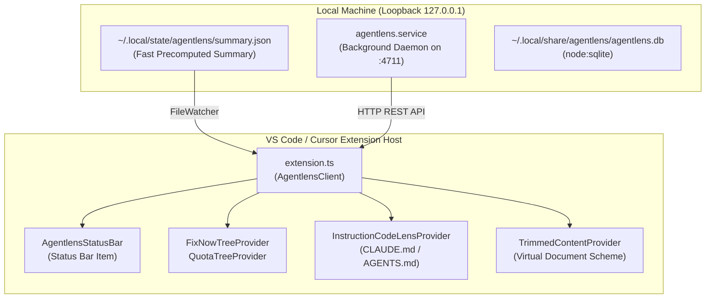

# VS Code & Cursor Extension Specification: vscode-agentlens ⚡

This document specifies the architecture, views, commands, and implementation design for creating an official **VS Code and Cursor extension** for **agentlens**.

---

## 🎯 Purpose & Developer Value

The **vscode-agentlens** extension bridges agentlens' token optimization and rate-limit forecasting directly into the developer's primary IDE (VS Code, Cursor, Windsurf, VSCodium):
1. **Ambient Status Bar**:
   - Live 5-hour quota and countdown: `$(zap) 68% (1h 42m) | 42k/h`.
   - Tooltip reveals exact reset times, today's measured tokens, and estimated API-equivalent cost.
2. **Dedicated Activity Bar & Sidebar Tree Views**:
   - **Quotas & Burn Rate**: Visual gauges for Claude Code, Codex, and Antigravity.
   - **Workspace "Fix Now" Panel**: Open recommendations and audit findings for the current workspace folder, with one-click "Copy Prompt" and "Send to Agent" buttons.
   - **Session Timeline & History**: Recent session turn counts, cache hit ratios, and retry loop warnings.
3. **In-Editor `CLAUDE.md` / `AGENTS.md` Enhancements**:
   - **CodeLens**: Displays fixed session token tax directly above line 1 (e.g. `3,420 tokens per session start · 4 trim cuts available`).
   - **Native Diff Preview for Instruction Trimmer**: Opens a side-by-side VS Code diff editor (`CLAUDE.md (Current)` vs. `CLAUDE.md (Trimmed Proposed)`) to review and merge cuts with native editor shortcuts.
   - **Diagnostic Squiggles**: Underlines duplicate directives, conflicting rules, or dead paths that no longer exist in the workspace.

---

## 🏗️ Architecture & Communication

The extension does **not** duplicate the ingestion engine, SQLite database, or waste detector logic. Instead, it operates as a lightweight client interacting with the existing local agentlens service:



### Communication Channels
1. **File Watcher on `summary.json`**:
   - Path: `<stateDir>/summary.json` (`~/.local/state/agentlens/summary.json` on Linux, `~/Library/Caches/agentlens/summary.json` on macOS).
   - Provides instant, sub-millisecond status bar updates whenever agent logs are updated, without polling HTTP.
2. **Local HTTP Client (`http://127.0.0.1:4711/api/*`)**:
   - `GET /api/quota`: Detailed window percentages and reset timers.
   - `GET /api/recommendations?project=<id>`: Workspace recommendations.
   - `GET /api/audit?project=<id>`: Instruction overhead and trimmer unified diffs.
   - `POST /api/fix/prompt`: Generates privacy-safe filled prompts for findings.
   - `POST /api/fix/run`: Dispatches agent fix runs via opt-in setting.

---

## 📁 Extension File Layout

```
vscode-agentlens/
├── package.json                   # Extension manifest and contributions
├── tsconfig.json                  # TypeScript compiler options
├── src/
│   ├── extension.ts               # Activation entry point
│   ├── client.ts                  # HTTP client & summary.json reader
│   ├── statusbar.ts               # Status bar manager
│   ├── providers/
│   │   ├── fixNowTreeProvider.ts  # Project recommendations tree view
│   │   ├── quotaTreeProvider.ts   # Quotas & burn rate tree view
│   │   ├── codelensProvider.ts    # CodeLens for CLAUDE.md / AGENTS.md
│   │   └── diffContentProvider.ts # Virtual document provider for trimmer diffs
│   └── commands/
│       ├── openDashboard.ts       # Open web UI in browser or simple browser
│       ├── copyPrompt.ts          # Copy prompt to clipboard
│       └── previewTrimDiff.ts     # Launch native side-by-side diff editor
└── assets/
    ├── icons/
    │   ├── agentlens-activity.svg # Activity bar icon
    │   └── zap.svg
    └── screenshots/
```

---

## 📝 Extension Manifest (`package.json`)

```json
{
  "name": "agentlens",
  "displayName": "agentlens: AI Agent Token & Quota Optimizer",
  "description": "Live quota forecasting, token waste detection, and instruction trimmer for Claude Code, Codex, OpenCode, and Cursor.",
  "version": "1.0.0",
  "publisher": "agentlens",
  "engines": {
    "vscode": "^1.90.0"
  },
  "categories": ["Other", "Programming Languages", "Linters"],
  "activationEvents": [
    "workspaceContains:**/CLAUDE.md",
    "workspaceContains:**/AGENTS.md",
    "workspaceContains:**/.claude/**",
    "workspaceContains:**/.codex/**",
    "onCommand:agentlens.openDashboard"
  ],
  "main": "./dist/extension.js",
  "contributes": {
    "viewsContainers": {
      "activitybar": [
        {
          "id": "agentlens-container",
          "title": "agentlens",
          "icon": "assets/icons/agentlens-activity.svg"
        }
      ]
    },
    "views": {
      "agentlens-container": [
        {
          "id": "agentlens.fixNow",
          "name": "Fix Now: Token Savings"
        },
        {
          "id": "agentlens.quotas",
          "name": "Quotas & Burn Rate"
        }
      ]
    },
    "commands": [
      {
        "command": "agentlens.openDashboard",
        "title": "Open agentlens Dashboard",
        "category": "agentlens",
        "icon": "$(globe)"
      },
      {
        "command": "agentlens.auditWorkspace",
        "title": "Audit Workspace Instructions & MCPs",
        "category": "agentlens"
      },
      {
        "command": "agentlens.previewTrimDiff",
        "title": "Preview Proposed Instruction Cuts",
        "category": "agentlens",
        "icon": "$(diff)"
      },
      {
        "command": "agentlens.generateIgnore",
        "title": "Generate Optimized .claudeignore",
        "category": "agentlens"
      }
    ],
    "menus": {
      "view/title": [
        {
          "command": "agentlens.openDashboard",
          "when": "view == agentlens.fixNow",
          "group": "navigation"
        }
      ],
      "view/item/context": [
        {
          "command": "agentlens.copyPrompt",
          "when": "viewItem == fixNowItem",
          "group": "inline"
        }
      ]
    },
    "configuration": {
      "title": "agentlens",
      "properties": {
        "agentlens.serverUrl": {
          "type": "string",
          "default": "http://127.0.0.1:4711",
          "description": "URL of the local agentlens dashboard server."
        },
        "agentlens.enableCodeLens": {
          "type": "boolean",
          "default": true,
          "description": "Show token cost and trim recommendations above CLAUDE.md and AGENTS.md."
        },
        "agentlens.statusBarAlignment": {
          "type": "string",
          "enum": ["left", "right"],
          "default": "right",
          "description": "Alignment of the agentlens quota indicator in the status bar."
        }
      }
    }
  }
}
```

---

## 💻 Key Component Implementations

### 1. Status Bar Item (`src/statusbar.ts`)
```typescript
import * as vscode from 'vscode';
import { AgentlensClient } from './client';

export class AgentlensStatusBar {
  private item: vscode.StatusBarItem;

  constructor(private client: AgentlensClient) {
    this.item = vscode.window.createStatusBarItem(
      vscode.StatusBarAlignment.Right,
      100
    );
    this.item.command = 'agentlens.openDashboard';
    this.update();

    // Listen to local summary.json changes
    client.onSummaryChange(() => this.update());
  }

  public async update(): Promise<void> {
    const summary = await this.client.getSummary();
    if (!summary || !summary.quotas || !summary.quotas['5h']) {
      this.item.text = '$(zap) agentlens';
      this.item.tooltip = 'Click to open agentlens dashboard';
      this.item.show();
      return;
    }

    const q5h = summary.quotas['5h'];
    const pct = Math.round(q5h.percent || 0);
    const reset = q5h.resetsAt ? this.formatCountdown(q5h.resetsAt) : '';
    const burn = summary.burnRatePerHour ? ` | ${Math.round(summary.burnRatePerHour / 1000)}k/h` : '';

    this.item.text = `$(zap) ${pct}%${reset ? ` (${reset})` : ''}${burn}`;
    
    if (pct >= 95) {
      this.item.backgroundColor = new vscode.ThemeColor('statusBarItem.errorBackground');
    } else if (pct >= 80) {
      this.item.backgroundColor = new vscode.ThemeColor('statusBarItem.warningBackground');
    } else {
      this.item.backgroundColor = undefined;
    }

    const md = new vscode.MarkdownString();
    md.isTrusted = true;
    md.appendMarkdown(`### agentlens Quota Guard\n\n`);
    md.appendMarkdown(`- **5-Hour Quota:** ${pct}% (Resets in ${reset})\n`);
    if (summary.quotas['7d']) {
      md.appendMarkdown(`- **7-Day Quota:** ${Math.round(summary.quotas['7d'].percent)}%\n`);
    }
    md.appendMarkdown(`- **Today's Spend:** ${summary.todayTokens?.toLocaleString()} tokens ($${summary.todayCost?.toFixed(2)})\n\n`);
    md.appendMarkdown(`[Open Dashboard](command:agentlens.openDashboard) · [Audit Instructions](command:agentlens.auditWorkspace)`);
    this.item.tooltip = md;
    this.item.show();
  }

  private formatCountdown(ts: number): string {
    const diffMin = Math.max(0, Math.round((ts - Date.now()) / 60_000));
    const h = Math.floor(diffMin / 60);
    const m = diffMin % 60;
    return h > 0 ? `${h}h ${m}m` : `${m}m`;
  }

  public dispose(): void {
    this.item.dispose();
  }
}
```

### 2. CodeLens for `CLAUDE.md` / `AGENTS.md` (`src/providers/codelensProvider.ts`)
```typescript
import * as vscode from 'vscode';
import { AgentlensClient } from './../client';

export class InstructionCodeLensProvider implements vscode.CodeLensProvider {
  constructor(private client: AgentlensClient) {}

  public async provideCodeLenses(document: vscode.TextDocument): Promise<vscode.CodeLens[]> {
    const fileName = document.fileName;
    if (!fileName.endsWith('CLAUDE.md') && !fileName.endsWith('AGENTS.md') && !fileName.endsWith('GEMINI.md')) {
      return [];
    }

    const tokenEstimate = Math.round(document.getText().length / 4);
    const topOfFile = new vscode.Range(0, 0, 0, 0);

    const auditLens = new vscode.CodeLens(topOfFile, {
      title: `$(file) ~${tokenEstimate.toLocaleString()} tokens per session start`,
      command: 'agentlens.auditWorkspace',
      tooltip: 'Calculated session token overhead. Click to view instruction audit.',
    });

    const trimLens = new vscode.CodeLens(topOfFile, {
      title: `$(diff) Preview Proposed Cuts`,
      command: 'agentlens.previewTrimDiff',
      arguments: [document.uri],
      tooltip: 'Open side-by-side diff editor showing duplicate lines and stale paths to cut.',
    });

    return [auditLens, trimLens];
  }
}
```

### 3. Native Side-by-Side Diff Provider (`src/commands/previewTrimDiff.ts`)
Opens VS Code's native diff viewer showing proposed cuts without modifying files:
```typescript
import * as vscode from 'vscode';
import { AgentlensClient } from '../client';

export async function previewTrimDiff(targetUri: vscode.Uri, client: AgentlensClient): Promise<void> {
  const originalDoc = await vscode.workspace.openTextDocument(targetUri);
  const auditData = await client.getAuditForWorkspace();
  
  const trimItem = auditData?.items?.find((item: any) => 
    item.sourcePath && targetUri.fsPath.endsWith(item.sourcePath)
  );

  if (!trimItem || !trimItem.proposedContent) {
    vscode.window.showInformationMessage('No cuts proposed for this instruction file. Everything looks clean!');
    return;
  }

  // Register or resolve virtual document with proposed content
  const proposedUri = targetUri.with({ scheme: 'agentlens-proposed' });
  client.registerVirtualDocument(proposedUri, trimItem.proposedContent);

  // Open native VS Code side-by-side diff editor
  await vscode.commands.executeCommand(
    'vscode.diff',
    targetUri,
    proposedUri,
    `${vscode.workspace.asRelativePath(targetUri)} ↔ Proposed Cuts (Save ~${trimItem.tokensSaved || 200} tokens)`
  );
}
```

---

## 🚀 Development & Packaging

1. **Install VS Code Extension CLI (`vsce`)**:
   ```bash
   npm install -g @vscode/vsce
   ```
2. **Build and Package as VSIX**:
   ```bash
   vsce package
   # Produces agentlens-1.0.0.vsix
   ```
3. **Install locally in VS Code or Cursor**:
   ```bash
   # In VS Code:
   code --install-extension agentlens-1.0.0.vsix
   # In Cursor:
   cursor --install-extension agentlens-1.0.0.vsix
   ```
