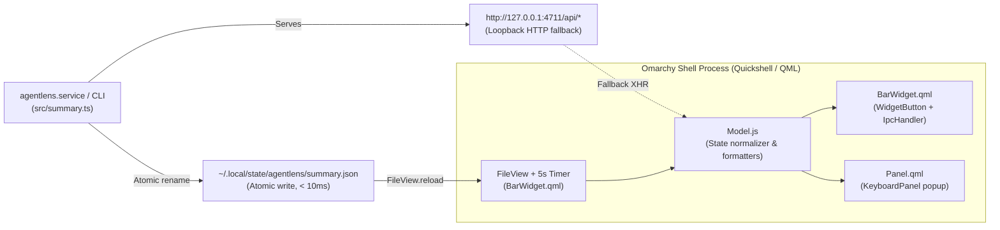

# Design Spec: `agentlens.bar-widget` Omarchy Quattro Plugin

**Date:** 2026-10-17  
**Author:** Sohail Elskhawy  
**Status:** Validated Design

---

## 1. Overview & Purpose

The **`agentlens.bar-widget`** plugin embeds real-time AI coding agent telemetry, quota pacing, token burn velocity, and waste remediation directly into the native **Omarchy Quattro** desktop shell (`omarchy-shell` / Quickshell).

### Key Capabilities
1. **Live Bar Widget (`BarWidget.qml`)**:
   - Displays the most constrained ("binding") 5-hour quota percentage across tracked agents (`claude`, `codex`), reset countdown, and active token burn velocity (`🔥 42.1k/h`).
   - Color-coded semantic states conforming to Omarchy theme tokens (`Color` and `Style` from `qs.Commons`):
     - **Normal**: `< 80%` quota used and not projected to exhaust within 30m.
     - **Warning**: `>= 80%` and `< 95%` quota used, or projected exhaustion before reset (`> 30m` away).
     - **Danger**: `>= 95%` quota used, or projected exhaustion within `<= 30m`.
   - Mouse interactions:
     - **Left-click**: Toggles the anchored popup panel (`Panel.qml`).
     - **Middle-click**: Forces an immediate state reload.
     - **Right-click**: Launches the local agentlens web dashboard (`http://127.0.0.1:4711`) in the default browser.
2. **Anchored Floating Details Panel (`Panel.qml`)**:
   - Built with native Omarchy UI components (`Panel`, `KeyboardPanel`, `PanelKeyCatcher`, `PanelHero`, `PanelSectionHeader`, `PanelSeparator`, `BorderSurface`, `Button`).
   - **Multi-Agent Limits & Pace**: 5-hour and 7-day progress bars for all active agents (`Claude Code`, `Codex`) with reset countdowns and pace exhaustion alerts.
   - **Today's Telemetry**: 3-column summary cards showing Today's Tokens, Est. API-Equivalent Cost (`$`), and Active Burn Rate (`/h`), plus the top 3 active projects today.
   - **#1 Priority "Fix Now" Card**: Displays the highest-impact open recommendation from `agentlens` with rule badge, project name, estimated weekly token savings, and a one-click **"Copy Fix Prompt"** action (`wl-copy` / `xclip`).
   - **Quick Actions**: Buttons to open the full dashboard (`http://127.0.0.1:4711`) or refresh telemetry.
3. **CLI Lifecycle Management (`agentlens plugin`)**:
   - `agentlens plugin install [--enable] [--dir <path>]` — Copies the plugin from `plugins/omarchy/agentlens.bar-widget/` into `~/.config/omarchy/plugins/agentlens.bar-widget/`, validates with `omarchy plugin validate`, rescans plugins in `omarchy-shell`, and enables `agentlens.bar-widget`.
   - `agentlens plugin status [--dir <path>]` — Reports installation status, manifest validity, and enabled state in `~/.config/omarchy/shell.json`.
   - `agentlens plugin uninstall [--dir <path>]` — Disables the plugin in Omarchy and removes `~/.config/omarchy/plugins/agentlens.bar-widget/`.

---

## 2. Architecture & Data Pipeline



### Enriched `summary.json` Schema (`src/summary.ts`)

`writeSummary(db, targetPath)` in `src/summary.ts` is extended with backward-compatible fields so `summary.json` contains everything the bar widget and panel need in a single file read:

```ts
export interface SummaryRecommendation {
  id: string;
  rule: string;
  severity: 'high' | 'medium' | 'low';
  title: string;
  action: string;
  estTokensSavedWeek: number;
  projectId?: number;
  projectName: string;
  prompt: string;
}

export interface SummaryData {
  updatedAt: number;
  totals: {
    tokensToday: number;
    costToday: number;
    burnRateTokensPerHour: number;
    activeSessions: number;
  };
  projects: Record<string, ProjectSummary>;
  quotas: {
    claude?: { '5h'?: number; '7d'?: number };
    codex?: { '5h'?: number; '7d'?: number };
  };
  forecasts?: QuotaForecastResult[];
  statuslineForecast?: string;
  topRecommendation?: SummaryRecommendation | null;
}
```

#### SQL Computations in `writeSummary()`
1. **`costToday`**: Computed alongside `tokensToday` in the `WHERE e.ts >= startOfToday` query using `coalesce(sum(e.cost), 0)`.
2. **`burnRateTokensPerHour` & `activeSessions`**:
   - Queries events in the last 60 minutes (`now - 3600_000`) for total tokens, and distinct `session_id` count in the last 15 minutes (`now - 900_000`) for `activeSessions`.
3. **`topRecommendation`**:
   - Queries the top open recommendation from `recommendations` ordered by severity (`high` > `medium` > `low`) and `est_tokens_saved_week DESC LIMIT 1`, joined with `projects` for `projectName` and `root`, and pre-generates `prompt` via `generateFixPrompt()`.

---

## 3. Repository & Plugin File Layout

```
plugins/omarchy/agentlens.bar-widget/
├── manifest.json        # Omarchy Quattro schemaVersion 1 manifest
├── BarWidget.qml        # BarWidget root with WidgetButton, FileView, Loader, IpcHandler
├── Panel.qml            # Panel + KeyboardPanel popup surface
├── Model.js             # Pure JS parser, binding window selector, and formatters
├── assets/
│   └── icon.svg         # Agentlens mark for PanelHero
└── README.md            # Setup, IPC, and customization reference
```

### `manifest.json` Contract
- `schemaVersion`: `1`
- `id`: `"agentlens.bar-widget"`
- `name`: `"agentlens Monitor"`
- `version`: `"1.0.0"`
- `author`: `"Sohail Elskhawy"`
- `license`: `"MIT"`
- `kinds`: `["bar-widget"]`
- `entryPoints`: `{ "barWidget": "BarWidget.qml" }`
- `barWidget`:
  - `displayName`: `"agentlens Quota"`
  - `description`: `"Live AI agent quota tracking, token burn speed, and waste alerts."`
  - `category`: `"AI"`
  - `aliases`: `["agentlens", "tokens", "quota", "claude", "codex"]`
  - `allowMultiple`: `false`
  - `defaultSection`: `"right"`
  - `defaults`: `{ "refreshIntervalSec": 5, "showCountdown": true, "showBurnRate": true, "dashboardUrl": "http://127.0.0.1:4711" }`
  - `schema`: Settings for `refreshIntervalSec` (integer 2–60), `showCountdown` (boolean), `showBurnRate` (boolean), and `dashboardUrl` (string).

---

## 4. Component Design

### 4.1 `Model.js` (Pure State & Formatting Logic)
Designed so it can be imported both by QML (`import "Model.js" as Model`) and by Node.js unit tests:
- `parseSummaryJson(rawText, nowMs)`:
  - Safely parses `summary.json` content and returns a normalized view model:
    - `hasData`: boolean
    - `bindingAgent`: `"claude" | "codex" | ""`
    - `binding5hPct`: number (`0..100`, or `-1` if no quota windows exist)
    - `binding5hReset`: string (e.g. `"1h 42m"` or `""`)
    - `bindingWillExhaustSoon`: boolean (exhaustion within `<= 30m`)
    - `severity`: `"danger" | "warning" | "normal"`
    - `tokensToday`: number
    - `costToday`: number
    - `burnRatePerHour`: number
    - `activeSessions`: number
    - `statuslineForecast`: string
    - `agentWindows`: array of `{ agent, agentLabel, window, title, usedPct, resetText, message, willExhaustBeforeReset, alarming }`
    - `topProjects`: top 3 projects sorted by `tokensToday DESC`
    - `topRecommendation`: normalized recommendation object or `null`
- `formatBarLabel(state, options)`:
  - Builds the bar pill text:
    - If `!state.hasData`: `"󱚣 --"`
    - If `binding5hPct >= 0`: `"⚡ " + binding5hPct + "%"` + (if `showCountdown && binding5hReset`: `" (" + binding5hReset + ")"`) + (if `showBurnRate && burnRatePerHour > 0`: `" · 🔥 " + formatTokens(burnRatePerHour) + "/h"`)
    - If no 5h quota snapshot exists yet but `tokensToday > 0`: `"⚡ " + formatTokens(tokensToday)` + (if `showBurnRate && burnRatePerHour > 0`: `" · 🔥 " + formatTokens(burnRatePerHour) + "/h"`)
- `formatTokens(n)` and `formatCost(usd)`:
  - Compact human-readable formatters (`193.1M`, `42.1k`, `$12.40`).

### 4.2 `BarWidget.qml`
- Inherits `BarWidget` from `qs.Ui`.
- Declares `moduleName: "agentlens.bar-widget"`.
- Uses `FileView` from `Quickshell.Io` pointing to `(Quickshell.env("XDG_STATE_HOME") || (Quickshell.env("HOME") + "/.local/state")) + "/agentlens/summary.json"`.
- Hosts `Loader` for `Panel.qml` and forwards `open()`, `close()`, `togglePanel()`, `opened`, `popoutSwitchClosing`, and `closeForPopoutSwitch()` following the exact `omarchy.clock` / `zakarch.storage` contract.
- Exposes `IpcHandler` (`target: "agentlens.bar-widget"`) with `open()`, `close()`, `toggle()`, `refresh()`, and `status(): string`.

### 4.3 `Panel.qml`
- Inherits `Panel` from `qs.Ui` with `KeyboardPanel` (`contentWidth: panel.fittedContentWidth(Style.space(380))`) and `PanelKeyCatcher` + `Flickable`.
- Sections:
  1. `PanelHero` with `assets/icon.svg`, title `"agentlens Monitor"`, subtitle `statuslineForecast || "Local AI Coding Telemetry"`, and a severity badge (`LIVE` / `WARN` / `LIMIT`).
  2. `LIMITS & PACE`: `Repeater` over `hostWidget.agentWindows` showing progress meters (`Meter`), percentage, reset countdown, and forecast warning text.
  3. `TODAY'S TELEMETRY`: 3-column stat grid (`Today's Tokens`, `Est. Cost`, `Burn Velocity`) + top active project rows.
  4. `PRIORITY FIX`: Highlighted `BorderSurface` card when `topRecommendation` exists, with rule title, project badge, savings estimate, and a `"Copy Fix Prompt"` `Button` that invokes `Quickshell.execDetached(["sh", "-c", ...])` to pipe the prompt to `wl-copy` (or `xclip -selection clipboard`).
  5. Footer action row with `"Open Dashboard"` and `"Refresh"` buttons.

### 4.4 CLI Plugin Manager (`src/omarchy-plugin.ts` & `src/cli.ts`)
- `installOmarchyPlugin(options)`:
  - Copies all files from `plugins/omarchy/agentlens.bar-widget/` to `<targetDir>/agentlens.bar-widget/`.
  - If `omarchy` CLI is available on `PATH` and `validate !== false`, runs `omarchy plugin validate`, `omarchy-shell shell rescanPlugins`, and (when `enable: true`) `omarchy plugin enable agentlens.bar-widget`.
- `getOmarchyPluginStatus(options)`:
  - Checks if manifest and QML files exist in `<targetDir>/agentlens.bar-widget/` and checks `~/.config/omarchy/shell.json` for `"agentlens.bar-widget"`.
- `uninstallOmarchyPlugin(options)`:
  - Runs `omarchy plugin disable agentlens.bar-widget` (if `omarchy` is on `PATH`), removes `<targetDir>/agentlens.bar-widget/`, and rescans plugins.

---

## 5. Error Handling & Edge Cases

1. **Missing `summary.json` & Offline Server**:
   - `FileView.onLoadFailed` triggers an HTTP fallback (`GET http://127.0.0.1:4711/api/summary` + `/api/quota`). If both fail, the widget stays visible in a non-intrusive dimmed state (`⚡ --`) with a helpful message inside the panel (`"Run 'agentlens serve' to start live telemetry"`).
2. **Atomic File Replacement (`renameSync`)**:
   - Because `writeSummary()` replaces `summary.json` via `renameSync`, `inotify` single-file watches can occasionally drop after rapid atomic renames. The 5-second `Timer` explicitly calls `summaryFile.reload()` so updates are never missed.
3. **Non-Omarchy Linux / macOS Environments**:
   - `agentlens plugin install` copies the plugin files cleanly even if the `omarchy` binary is not installed, reporting whether live shell activation was performed or skipped.

---

## 6. Testing & Verification Plan

1. **Enriched `summary.json` Unit Tests (`test/summary.test.ts`)**:
   - Verify `writeSummary()` populates `totals.costToday`, `totals.burnRateTokensPerHour`, `totals.activeSessions`, and `topRecommendation` (including generated fix prompt).
2. **Plugin Model & CLI Unit Tests (`test/omarchy-plugin.test.ts`)**:
   - Load `plugins/omarchy/agentlens.bar-widget/Model.js` directly in Node tests and verify `parseSummaryJson()`, binding 5h window selection, severity calculation (`normal`, `warning`, `danger`), and `formatBarLabel()`.
   - Test `installOmarchyPlugin()`, `getOmarchyPluginStatus()`, and `uninstallOmarchyPlugin()` against a temporary config directory.
3. **Live Omarchy Shell Verification**:
   - Run `agentlens plugin install --enable`.
   - Validate with `omarchy plugin validate ~/.config/omarchy/plugins/agentlens.bar-widget`.
   - Confirm live IPC response from the running shell via `omarchy-shell agentlens.bar-widget status`.
